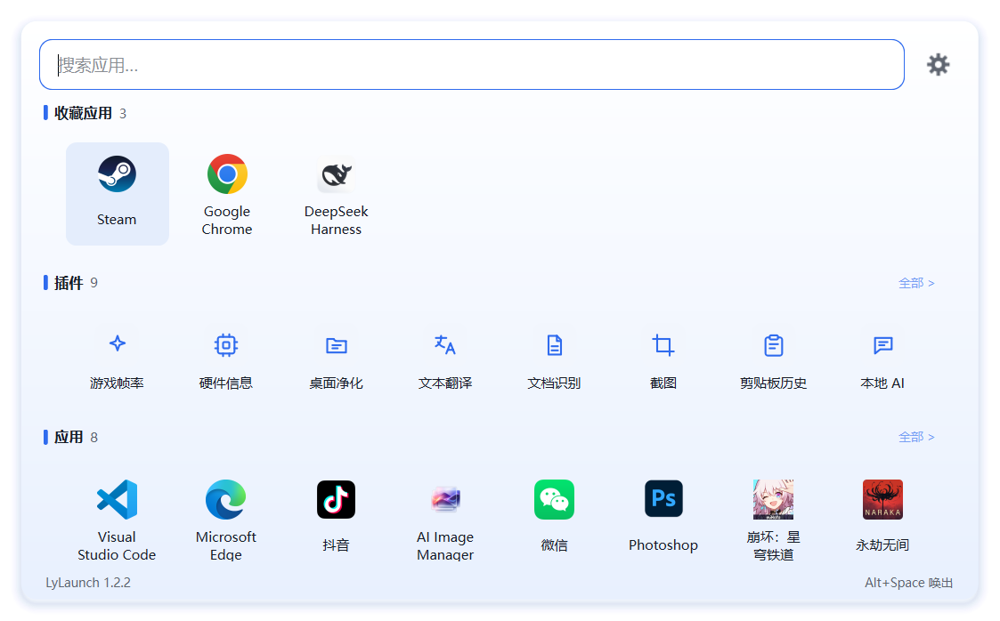
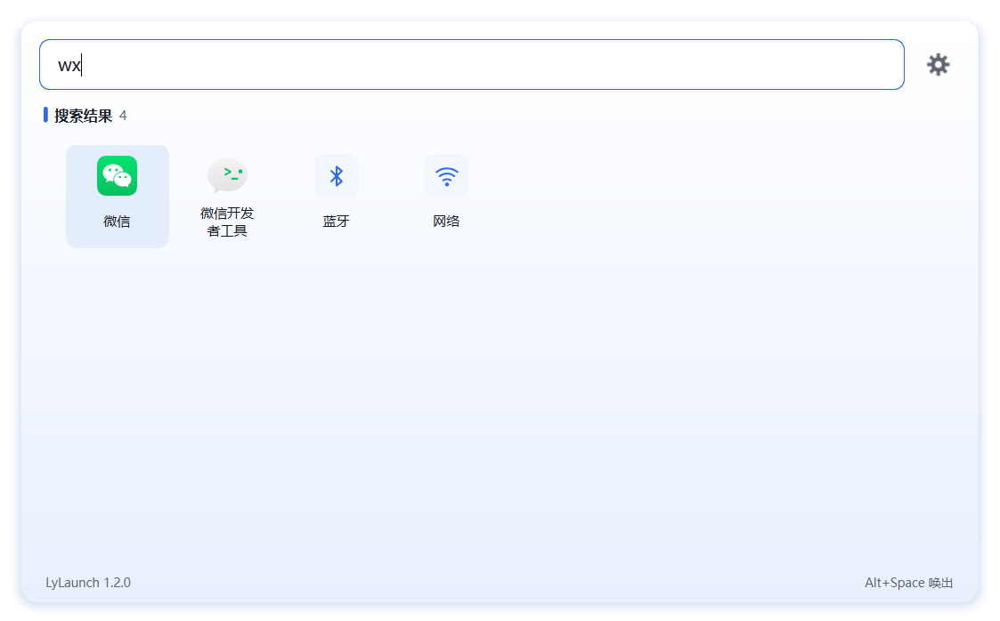

<div align="center">


# LyLaunch · 轻快启动

**一个热键唤起的极简 Windows 启动器：搜应用、翻剪贴板、开插件，纯本地不上传**

Python · PySide6 · Windows 原生 API · Apache-2.0

</div>

<p align="center">
  
</p>

**装起来三行**：`git clone https://github.com/LiyueDev/LyLaunch.git` → `pip install -r requirements.txt` → `python main.py`，然后按 `Alt+Space`（需要 Windows 10/11 + Python 3.10–3.14，细节见[快速开始](#快速开始)）

---

## 这是什么

按一下热键，浮窗弹出，输入拼音首字母就能打开本机任意应用或文件；再按 `Esc` 收起。它常驻托盘，像一个更轻的 uTools —— 没有账号、没有云同步、不联网也能用。

**从 0.1 迭代到 1.2.2**：核心 53 个模块、13,000+ 行，加上 9 个内置插件共 32,000+ 行 Python。纯本地运行，无账号、无云同步。

**能让本地模型给别人用**：1.2.2 起有一套独立的外部集成 Router（`127.0.0.1:18091`），一个开关把 llama.cpp 的显存整块让给 DeepSeek Harness 这类本机 agent，关掉就又回到插件自己用。不启用时零网络请求。

## 功能

| 能力 | 说明 |
|---|---|
| 全局热键唤起 | 默认 `Alt+Space`，可自定义；按拼音首字母搜应用（`wx` → 微信） |
| 应用/文件搜索 | 扫描开始菜单与桌面的 `.lnk`，解析真实目标后取高清图标（无快捷方式箭头） |
| 剪贴板历史 | 后台记录文本剪贴板，一键写回；上限 200 条 |
| 插件系统 | 目录即插件，`plugin.json` 声明清单，支持启停、独立热键、拖拽排序 |
| 内置插件 | 游戏帧率、文本翻译、截图、OCR（图片转文字）、剪贴板历史、硬件信息、桌面净化、文档识别、本地 AI |
| 本地 AI（可选） | 内置 llama.cpp 运行时，插件可调用本地模型；不启用时零网络请求 |

## 界面

<p align="center">
  
</p>

输入 `wx` 就出结果 —— 拼音首字母直接命中，不用切输入法，也不用记完整名字。

两张都是实机截图，不是示意图。其余视图（桌面净化、文档识别、设置页）见站点 <https://liyuedev.github.io>。

## 快速开始

环境：Windows 10/11，**Python 3.10 – 3.14**（推荐 3.13 / 3.14，开发环境为 3.14.7）

> ⚠️ **Python 3.15 暂不支持**：依赖锁定的 PySide6 6.11.x 要求 `<3.15`，用它装依赖会失败。

```bash
git clone https://github.com/LiyueDev/LyLaunch.git
cd LyLaunch
python -m pip install -r requirements.txt
python main.py
```

- 首次运行会在 `%LocalAppData%\LyLaunch\` 建数据目录（配置、插件、日志都在这里）。
- 离线翻译模型（约 140MB）不随仓库分发，首次使用对应插件时自动下载。

### 内置插件

9 个插件全部随程序分发、安装后自动启用，无需手动安装：

游戏帧率、剪贴板历史、桌面净化、文档识别、硬件信息、本地 AI、图片转文字、截图、文本翻译。

### 本地 AI 对话的运行时

`llm_chat`（本地 AI）与 `doc_recognize`（文档识别）依赖 llama.cpp 运行时。安装包已内置
`llama-server.exe`；**源码运行**时才需要自行准备：从
[llama.cpp releases](https://github.com/ggml-org/llama.cpp/releases) 下载 Windows 版，
把 `llama-server.exe` 放到仓库根目录的 `runtime/` 下。模型按需下载，不随包分发。

## 技术栈

| 层 | 选型 | 为什么 |
|---|---|---|
| GUI | **PySide6 6.11（LGPLv3）** | Qt 官方绑定，LGPL 允许闭源分发；不用 PyQt6 是因为 GPLv3 的许可成本 |
| 系统能力 | `ctypes` + `pywin32` | 全局热键、图标提取、快捷方式解析、单实例都没有现成封装，直接调 Win32 / COM |
| 拼音 | `pypinyin` | 首字母搜索；懒加载（顶层 import 会多吃 49MB 内存） |
| 离线翻译 | `ctranslate2` + `sentencepiece` | 本地推理，不联网 |
| OCR | `rapidocr` 3.x（PP-OCRv6） | 纯离线，模型随包 |
| 本地推理 | llama.cpp Router | 单进程常驻，插件共享一个 `127.0.0.1:18090` |

## 项目结构

```
main.py                  入口：单实例 → QApplication → 主窗口 + 托盘
lylaunch/                核心库
├── ui/                  浮窗、设置页、开关控件
├── plugins/             插件框架（加载器 / API / 注册表 / 主题）
├── engine/              本地推理引擎（llama.cpp router 管理）
├── hotkey.py            全局热键（RegisterHotKey + 原生消息）
├── single_instance.py   单实例（命名 Mutex + 内核事件）
├── icons.py             图标提取（HICON → QImage，后台线程）
├── clipboard.py         剪贴板轮询
├── search_rank.py       相关度打分（应用与插件共用）
└── paths.py             资源路径 / 数据目录
plugins/                 内置插件（9 个，每个目录一个插件，随程序分发）
```

## 架构

```
                    ┌──────────── 常驻进程（单实例 Mutex）────────────┐
 全局热键 ────────► │  MainWindow 浮窗 ◄── 插件面板（非模态单例）      │
 (RegisterHotKey)   │      │                                         │
                    │      ├─ search_index ─► 应用/文件 → search_rank │
 托盘图标 ◄────────► │      ├─ IconLoader(QThread) ─► HICON → QImage   │
                    │      ├─ ClipboardWatcher（700ms 轮询）          │
                    │      └─ PluginManager ─► importlib 动态加载     │
                    │                              │                  │
                    │                     PluginAPI 限定系统能力       │
                    │                              │                  │
                    │              EngineManager ─► llama.cpp router   │
                    └─────────────────────────────────────────────────┘
```

- **进程模型**：一个常驻进程，托盘驻留，主窗口只 `hide()`；第二次启动靠内核事件唤出已有实例。
- **插件隔离**：插件只能通过 `PluginAPI` 触达系统，跨插件调用走 `api.invoke_plugin(id, query)`。
- **线程模型**：图标提取、模型下载在后台线程；UI 只在主线程改。

## 插件机制

一个插件就是一个目录：

```
plugins/my_plugin/
├── plugin.json    # Id（必须等于目录名）、Name、Version、Main、EntryClass、Keywords、Hotkey
└── main.py        # 定义 EntryClass 指定的类，继承插件基类
```

要点（完整规范见 [`plugins/_README.md`](plugins/_README.md)）：

- 插件主窗口**禁用模态 `exec()`** —— 常驻程序跑嵌套事件循环会卡死主浮窗的失焦隐藏逻辑。
- 插件通过 importlib 动态加载；新增第三方依赖时请同步写入 requirements.txt。
- 插件入口文件**不要用 `@dataclass` 装饰**（`exec_module` 不注册 `sys.modules`，动态加载时会抛 `AttributeError`）。

## 已知限制

- 仅支持 Windows（大量依赖 Win32 API）。
- 剪贴板只处理文本，不处理图片/文件。
- 剪贴板轮询间隔 700ms：极短时间内连续复制可能被合并。
- 暂无单元测试，目前靠手工冒烟验证（明确的待补项）。

## 路线图

- [ ] 插件市场（远程列表 + 一键安装；本地包库已通）
- [ ] 插件安全沙箱（限制文件 / 网络访问）
- [ ] 单元测试与 CI
- [ ] 插件真实图标（manifest 声明）

## 许可

本项目采用 [Apache-2.0](LICENSE) 许可证开源，可自由使用、修改与分发。

第三方组件按其各自许可证分发：PySide6（LGPLv3）、llama.cpp（MIT）、RapidOCR（Apache-2.0）、
CTranslate2（MIT），详见下方「致谢」。

界面图标与品牌标识均为项目自绘的线性 SVG。

## 致谢

- [Qt for Python (PySide6)](https://doc.qt.io/qtforpython/) — LGPLv3
- [llama.cpp](https://github.com/ggml-org/llama.cpp) — MIT
- [RapidOCR](https://github.com/RapidAI/RapidOCR) — Apache-2.0
- [CTranslate2](https://github.com/OpenNMT/CTranslate2) — MIT
